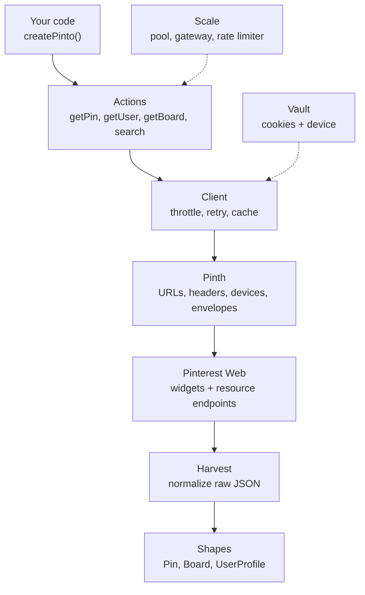

Pinto reads Pinterest the same way the Pinterest website does: it sends plain HTTP requests to Pinterest's public web endpoints and turns the JSON that comes back into typed objects. There is no browser involved. The work is split into a few small modules, and the most important one is **Pinth**.

## The layers at a glance

| Module | Role |
| --- | --- |
| **Pinth** | The protocol layer. Knows Pinterest's URLs, endpoints, request headers, device profiles, and response envelopes. |
| **Actions** | The public methods you call, such as `getPin`, `getUser`, `getBoard`, and `search`. |
| **Client** | The transport. Sends requests with per-session throttling, retries, timeouts, and a small cache. |
| **Vault** | Stores session state: cookies, the CSRF token, and the device profile. |
| **Harvest** | Turns Pinterest's raw, inconsistent JSON into clean objects. |
| **Shapes** | The TypeScript types Pinto returns (`Pin`, `Board`, `UserProfile`, `Page`). |
| **Media** | Downloads images and videos and detects their formats. |
| **Scale** | Optional production tooling: session pool, shared cache, global rate limiter, and gateway. |

## Pinth: the protocol layer

Pinth is the part of Pinto that "speaks Pinterest". It lives in its own folder in the repository (`Pinth/`), separate from the rest of the library, so that when Pinterest changes something on its side, the fix usually stays inside Pinth.

Pinth has five jobs.

<AccordionGroup>
  <Accordion title="URLs: understand any Pinterest link" icon="link">
    Pinth accepts almost anything you paste and works out what it points to. `parsePinterestRef` turns an input into a `pin`, `user`, or `board` reference.

    - Recognizes Pinterest on many country domains (`pinterest.co.uk`, `pinterest.fr`, `pinterest.com.au`, and more) and canonicalizes them to `www.pinterest.com`.
    - Extracts pin IDs, usernames, and `owner/slug` board paths, while skipping reserved paths such as `search`, `settings`, or `ideas`.
    - Resolves `pin.it` short links by following the redirect.
    - Builds the endpoint URLs Pinto calls, such as the widget pin-info URL or the resource URL for a handler.
  </Accordion>

  <Accordion title="Endpoints: two ways in" icon="route">
    Pinterest exposes two families of public web endpoints, and Pinth knows both:

    - **Widget endpoints** on `widgets.pinterest.com` (`/v3/pidgets/...`). These are the endpoints Pinterest's embed widgets use. Pinto uses them for pins, user pins, and board pins. They need no login.
    - **Resource endpoints** on `www.pinterest.com/resource/<Name>/get/`. These power the Pinterest web app. Pinto uses `BaseSearchResource` for search. They expect a CSRF token, which Pinto gets automatically.
  </Accordion>

  <Accordion title="Headers: look like a real browser" icon="window-maximize">
    Each request type gets the header set a real browser would send:

    - `bootstrapHeaders` for the first page load that collects cookies.
    - `apiHeaders` for resource calls, including `X-CSRFToken` and the `X-Pinterest-PWS-Handler` header.
    - `widgetHeaders` for widget calls.
    - `mediaHeaders` for image and video downloads.

    All of them include the session's user agent, language, and client hints (`Sec-Ch-Ua`, `Sec-Ch-Ua-Platform`).
  </Accordion>

  <Accordion title="Devices: one identity per session" icon="fingerprint">
    Pinth carries a set of real browser profiles (Chrome, Edge, Firefox, Safari, and Opera on Windows, macOS, Linux, Android, and iOS) and a set of locales. When a session starts, one profile and one locale are picked at random and stored on the session, so the same session always looks like the same device. See [Device fingerprinting](/pinto/fingerprinting).
  </Accordion>

  <Accordion title="Envelopes: unwrap the response" icon="box-open">
    Widget and resource responses wrap their data differently. Pinth's readers (`readWidget`, `readWidgetRows`, `readFeed`) pull out the items and, for feeds, the **bookmark** cursor Pinterest uses for pagination. A bookmark of `-end-` means there are no more pages.
  </Accordion>
</AccordionGroup>

## What happens when you call `getPin`

<Steps>
  <Step title="Resolve the input">
    If you passed a `pin.it` short link, Pinth follows the redirect. It then extracts the numeric pin ID from the URL or string.
  </Step>
  <Step title="Build the request">
    Pinth builds the widget pin-info URL and the right headers for this session's device.
  </Step>
  <Step title="Send it through the Client">
    The Client checks its cache, waits for the session's throttle slot (a small gap plus random jitter between requests), and sends the request with a timeout.
  </Step>
  <Step title="Unwrap and normalize">
    Pinth unwraps the response envelope, and Harvest turns the raw row into a `Pin`: title, description, images sorted by size, image format and MIME type, link, domain, dominant color, save count, and more.
  </Step>
  <Step title="Return a typed object">
    You get a `Pin` back. If nothing matched, Pinto throws a `NotFoundError`.
  </Step>
</Steps>

Search follows the same path but goes through a resource endpoint. Before the first resource call, the Client loads the Pinterest home page once to collect cookies and a `csrftoken`, then sends every later call with that token.

## The Client: polite, resilient transport

Every request goes through the Client, which keeps one transport per session. It handles:

- **Throttling:** a minimum gap between requests on the same session, plus random jitter, so requests don't arrive in a perfectly regular pattern.
- **Retries:** rate limits (`429`), blocks (`403`), server errors (`5xx`), and network failures are retried with exponential backoff. If Pinterest sends `Retry-After`, Pinto waits that long instead.
- **Timeouts:** each request is aborted if it takes too long.
- **Caching:** successful responses are kept briefly in a small in-memory cache so repeated reads don't hit Pinterest again. Call `clearCache()` to empty it.
- **Cookie tracking:** cookies Pinterest sets are stored back into the session after every response.

See [Configuration](/pinto/configuration) for the exact defaults and [Errors](/pinto/errors) for the error types.

## Vault: session state

A session in Pinto is a small object holding cookies, the CSRF token, and the device profile. Vault creates, imports, and saves it.

- `useMemorySession()` keeps the session in memory.
- `useFileSession(dir)` saves it to `session.json` so it survives restarts.
- `importCookies()` accepts cookies in many formats: a cookie header string, JSON, browser-extension exports, Playwright storage state, Netscape `cookies.txt`, `Set-Cookie` lines, or even a copied `curl` command.

Pinto works anonymously by default. Logged-in cookies are optional. See [Authentication](/pinto/authentication).

## Harvest: from raw JSON to clean objects

Pinterest's JSON is large and changes shape between endpoints. Harvest reads it defensively: it tries several field names for each value, ignores missing fields, and produces the same `Pin`, `Board`, or `UserProfile` shape no matter which endpoint the data came from.

## Scale: running many sessions

For heavy workloads, Scale adds a layer above Actions:

- **SessionPool** keeps several sessions and routes each request to the least busy one. A session that gets rate limited or blocked is put on cooldown.
- **Gateway** shares a cache across sessions and **coalesces** identical requests that are in flight at the same time, so ten callers asking for the same pin trigger one request.
- **GlobalRateLimiter** caps request rate per host across all sessions.

See [Scaling](/pinto/scaling).

<Card title="Next: Quickstart" icon="arrow-right" href="/pinto/quickstart" horizontal>
  Install Pinto and read your first pin.
</Card>
