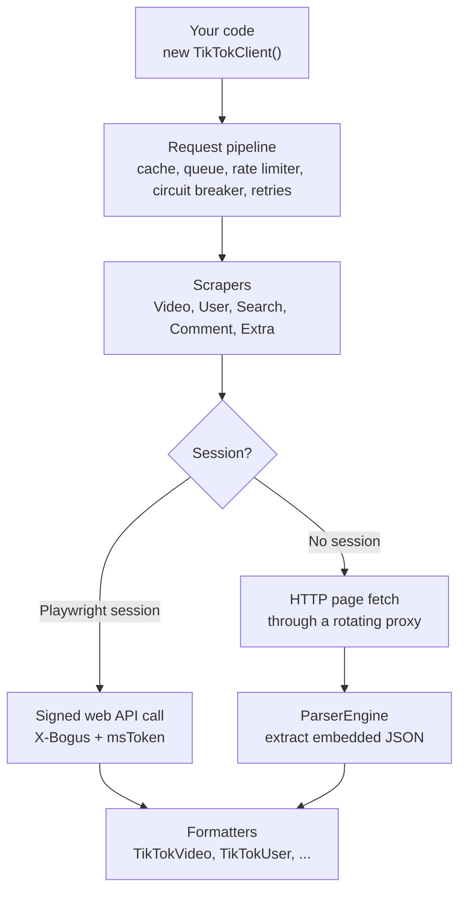

The TikTok SDK reads public TikTok data the way a browser does. For most calls it loads TikTok's web pages or web API endpoints over plain HTTP, pulls out the JSON TikTok embeds in the page, and returns it in a clean, typed shape. A real browser is only used if you choose to add one.

## The layers at a glance

| Component | Role |
| --- | --- |
| **TikTokClient** | The public entry point. Exposes `getVideo`, `getUser`, `getComments`, `searchUsers`, and the other methods. |
| **Core** | The request pipeline: `CacheManager`, `RequestQueue`, `RateLimiter`, `CircuitBreaker`, `RetryHandler`, `Proxymanager`, `SessionManager`, and `Signer`. |
| **Scrapers** | One per data type: `VideoScraper`, `UserScraper`, `SearchScraper`, `CommentScraper`, and `ExtraScraper` (hashtags, sounds, trending, playlists, liked videos). |
| **ParserEngine** | Finds TikTok's data inside a page's HTML using several strategies. |
| **ProxiflyProvider** | Loads and refreshes a proxy list automatically. |
| **PlaywrightSession** | Optional. A real Chromium session for signed API calls and rendered pages. |

## The request pipeline

Every method call on `TikTokClient` passes through the same steps.

<Steps>
  <Step title="Cache">
    The client checks `CacheManager` first. A recent result for the same input is returned immediately.
  </Step>
  <Step title="Queue">
    The call joins `RequestQueue`, which limits how many requests run at once (concurrency) and runs higher-priority tasks first.
  </Step>
  <Step title="Rate limiter">
    `RateLimiter` is a token bucket. It allows a set number of requests per second, with short bursts up to twice that rate.
  </Step>
  <Step title="Circuit breaker">
    `CircuitBreaker` watches for repeated failures. After several failures in a row it "opens" and fails fast for a cooldown period instead of hammering TikTok. It then lets a trial request through and closes again once requests succeed.
  </Step>
  <Step title="Proxy and retries">
    The client picks a proxy from `Proxymanager`, runs the scraper, and reports how the proxy performed. If the attempt fails, it retries up to `maxRetries` times, usually with a different proxy.
  </Step>
  <Step title="Format">
    The raw TikTok item is turned into a clean object such as `TikTokVideo`, with formatted dates, durations, available video formats, subtitles, and image posts.
  </Step>
</Steps>

The defaults for rate limit, retries, cache TTL, concurrency, and timeout are listed in [Configuration](/tiktok-sdk/configuration).

## Two ways to get data

Each scraper tries the strongest method available and falls back to the next one.

<Tabs>
  <Tab title="With a Playwright session">
    If you pass a ready [Playwright session](/tiktok-sdk/playwright-sessions), the scraper first calls TikTok's own web API (for example `/api/item/detail/`) from inside the browser page. This is the most reliable path because the request carries real browser cookies and a valid signature.

    If that call fails, the session can **render** the page in the browser and hand the HTML to the ParserEngine.
  </Tab>
  <Tab title="Without a session">
    With no session, the scraper downloads the public TikTok page over HTTP through a proxy, using desktop browser headers. If the HTML comes back suspiciously short, the SDK treats it as a block from TikTok's firewall and raises a `TikTokWafError`, which triggers a retry.

    The HTML is then passed to the ParserEngine.
  </Tab>
</Tabs>

## ParserEngine: finding the data in the page

TikTok embeds the data for each page as JSON inside a `<script>` tag, but the exact location changes over time and even between regions. The ParserEngine tries several strategies in order and stops at the first one that works:

1. **Universal data:** reads the `__UNIVERSAL_DATA_FOR_REHYDRATION__` script. It checks the known paths first, then searches the whole object for anything that looks like a video item.
2. **SIGI state:** reads the older `SIGI_STATE` script.
3. **Inline scripts:** scans the page's other scripts for item data.
4. **LD+JSON:** falls back to the structured-data block TikTok includes for search engines.

If none of them work, it throws a `TikTokParseError` that says how many strategies were tried.

## Signing requests: X-Bogus

TikTok's web API rejects requests without a valid `X-Bogus` signature. The SDK handles this in two ways:

- **Inside a Playwright session**, it waits for TikTok's own signing function (`byted_acrawler.frontierSign`) to load in the page and asks it to sign each URL. It also uses the `msToken` cookie TikTok sets in the browser.
- **Without a browser**, the `Signer` module computes the `X-Bogus` value locally from the query string and user agent. `sign` and `signUrl` are exported if you need them directly.

## Proxies

By default, the SDK fetches a free proxy list from the Proxifly project and refreshes it every few minutes. `Proxymanager` rotates through the list using `round-robin`, `random`, or `lowest-failures`, and tracks which proxies succeed, how fast they are, and which ones fail. You can pass your own proxies instead, which is recommended for production. See [Proxies](/tiktok-sdk/proxies).

## Playwright sessions in detail

When you start a `PlaywrightSession`, it:

- launches Chromium with automation flags turned off,
- injects a stealth script that sets realistic `navigator` values (platform, languages, memory, CPU cores),
- opens TikTok's For You page to collect the `msToken` and CSRF cookies,
- builds the standard TikTok web parameters (app ID, device ID, region, screen size, and so on),
- and recreates the page automatically if it crashes.

Playwright is an optional dependency. The SDK only loads it when you create a session. See [Playwright sessions](/tiktok-sdk/playwright-sessions).

<Card title="Next: Installation" icon="arrow-right" href="/tiktok-sdk/installation" horizontal>
  Install the SDK and make your first request.
</Card>
